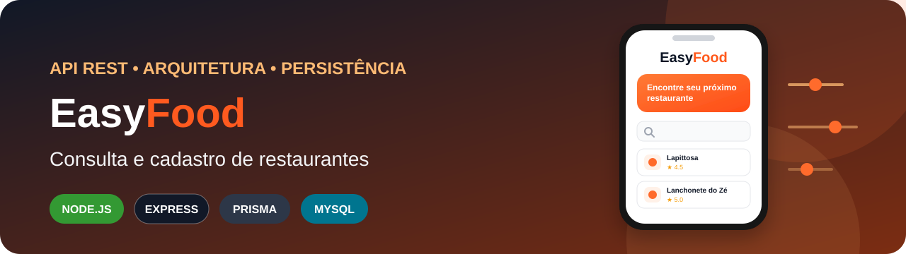

<p align="center"></p>

<p align="center">
  <a href="https://github.com/sandrozdb/easyfood-api/actions/workflows/ci.yml"></a>
  <a href="LICENSE"></a>
  
  
</p>

# EasyFood

MVP acadêmico de descoberta e gestão de restaurantes. O projeto usa Node.js, Express, MySQL e Prisma em um monólito modular com autenticação real, RBAC, ownership, imagens privadas, avaliações, auditoria e e-mails transacionais.

## Funcionalidades

- CRUD completo de restaurantes e pratos, com persistência MySQL;
- Google → AWS Cognito → access JWT → middleware Express → usuário local;
- perfis `cliente`, `restaurante` e `admin`, sincronizados de `cognito:groups` na prioridade `admin > restaurante > cliente`;
- proteção por JWT, role, ownership e contra IDOR;
- disponibilidade, imagens privadas e URLs presignadas para pratos;
- foto de perfil do usuário autenticado;
- avaliações com nota inteira de 1 a 5, comentário opcional, média real e `reviewCount`;
- Activity Log administrativo;
- EmailService best-effort com MailerSend;
- interface web e suíte automatizada com **211 testes aprovados**.

## Arquitetura

```text
Frontend → Routes → Controller → Service → Repository → Prisma → MySQL
                     │
                     ├→ Activity Log
                     ├→ EmailService → EmailProvider → MailerSendProvider
                     └→ Multer → ImageService → Sharp → StorageService → S3 privado
```

Os módulos ficam em `src/modules/`. Controllers traduzem HTTP, services aplicam regras, repositories isolam persistência e adapters encapsulam Cognito, MailerSend e S3.

## Como executar

Requisitos: Node.js 22+, MySQL 8 e acesso local às configurações utilizadas.

```powershell
npm install
if (-not (Test-Path ".env")) { Copy-Item ".env.example" ".env" }
notepad .env
npm run prisma:generate
npm run db:seed
npm start
```

Abra [http://localhost:3000](http://localhost:3000). Nunca versione `.env` ou credenciais reais.

## Migrations

Em uma base existente, faça backup e aplique em ordem:

1. `001-cognito-users.sql`
2. `002-create-dishes.sql`
3. `003-add-dish-image-key.sql`
4. `004-create-activity-logs.sql`
5. `005-create-reviews.sql`
6. `006-add-user-profile-image.sql`

Os arquivos estão em `database/migrations/`. Não são aplicados automaticamente pelo Prisma.

## Autenticação e autorização

A autenticação Cognito está implementada. O backend valida assinatura, issuer, expiração, client, `token_use` e scope do JWT antes de consultar ou sincronizar o usuário local.

| Perfil | Permissões principais |
| --- | --- |
| cliente | consultas públicas, perfil e próprias avaliações |
| restaurante | próprio restaurante e próprios pratos |
| admin | gerenciamento global de restaurantes, pratos e usuários |

O frontend nunca define role, proprietário ou autor. Consulte [autenticacao-cognito-google.md](docs/autenticacao-cognito-google.md) e [ADR-006](docs/adr/ADR-006-autenticacao-cognito-google-rbac.md).

## API principal

### Restaurantes e pratos

| Método e rota | Acesso |
| --- | --- |
| `GET /restaurants` | público |
| `POST /restaurants` | restaurante ou admin |
| `PUT/PATCH /restaurants/:id` | proprietário ou admin |
| `DELETE /restaurants/:id` | admin |
| `GET /restaurants/:restaurantId/dishes` | público |
| `POST /restaurants/:restaurantId/dishes` | proprietário ou admin |
| `GET /dishes/:dishId` | público |
| `PUT/PATCH/DELETE /dishes/:dishId` | proprietário ou admin |
| `GET /dishes/managed` | restaurante ou admin |

`Restaurant` possui relação 1:N com `Dish`. A API revalida ownership na escrita para impedir IDOR.

### Reviews

| Método e rota | Acesso |
| --- | --- |
| `GET /restaurants/:restaurantId/reviews` | público |
| `POST /restaurants/:restaurantId/reviews` | cliente |
| `GET /reviews/me` | cliente |
| `PUT/PATCH /reviews/:reviewId` | autor |
| `DELETE /reviews/:reviewId` | autor |

Existe uma review por cliente/restaurante. `averageRating` e `reviewCount` são derivados das reviews; `restaurants.rating` foi preservado apenas por compatibilidade e não é a fonte de verdade.

## Favoritos

Clientes autenticados podem salvar restaurantes e consultar sua lista pessoal. A identidade sempre vem do JWT validado; o frontend não envia `userId`.

| Rota | Acesso |
| --- | --- |
| `POST /restaurants/:restaurantId/favorite` | cliente |
| `DELETE /restaurants/:restaurantId/favorite` | cliente |
| `GET /restaurants/:restaurantId/favorite` | cliente |
| `GET /favorites/me` | cliente |

A migration aditiva `007-create-favorites.sql` cria a relação N:N entre clientes e restaurantes. A restrição única impede duplicidade e a página `/favorites.html` exibe os restaurantes salvos com avaliação agregada.

## Busca, filtros e ordenação

`GET /restaurants` permanece público e aceita os parâmetros opcionais `search`, `category`, `minRating` (`3`, `4` ou `4.5`) e `sort` (`name_asc`, `name_desc`, `rating_desc`, `reviews_desc` ou `recent_desc`). Exemplo: `GET /restaurants?search=pizza&category=Pizza&minRating=4&sort=rating_desc`.

A página inicial combina os filtros, mantém o estado na URL e aplica debounce de 300 ms na busca. A nota mínima e as ordenações por avaliação usam `averageRating` e `reviewCount` derivados de Reviews, não o campo legado `rating`.

## Dashboard

O dashboard do restaurante reúne pratos disponíveis e indisponíveis, média e distribuição das Reviews, quantidade de Favoritos e cinco avaliações recentes, sempre com o restaurante identificado pelo usuário autenticado. O painel administrativo apresenta totais reais de usuários, restaurantes, pratos, Reviews, Favoritos e atividades recentes. Os endpoints públicos não foram alterados e nenhuma métrica de vendas, pedidos ou faturamento é inventada.

## Imagens privadas

Fluxo oficial:

```text
Frontend → multipart/form-data → Multer → ImageService → Sharp
         → StorageService → AWS S3 privado → image_key no MySQL
         → URL presignada na leitura
```

Multer usa `memoryStorage`, campo `image`, um arquivo e limite de 5 MB. O ImageService compartilhado por User e Dish valida bytes reais, aceita JPEG/PNG/WebP, corrige orientação, redimensiona, converte para WebP e usa qualidade 80.

- preset `profile`: até 512×512, `cover`, sem upscale;
- preset `dish`: até 1600 px, proporção preservada, sem upscale.

Rotas de perfil:

- `GET /auth/me` — perfil e URL presignada temporária;
- `POST /auth/me/image` — multipart, sempre para `req.user`;
- `DELETE /auth/me/image` — remove a própria foto.

Object key: `easyfood/users/{userId}/profile/{uuid}.webp`. O frontend não envia `userId`. Para pratos, o frontend também usa FormData; corpo binário permanece somente como compatibilidade temporária. O banco persiste apenas object keys, nunca URLs presignadas.

O bucket continua privado. Em desenvolvimento, use AWS Profile/SSO; em produção, prefira IAM Role. Credenciais nunca chegam ao navegador. Veja [aws-s3-setup.md](docs/aws-s3-setup.md), [ADR-008](docs/adr/ADR-008-imagens-aws-s3.md) e [ADR-010](docs/adr/ADR-010-image-service-compartilhado.md).

## EmailService

Fluxo: `Domain Service → EmailService → EmailProvider → MailerSendProvider`. Notificações são best-effort: falha externa não desfaz operações concluídas. Testes usam provider falso e não enviam e-mail real. Para teste manual explicitamente configurado: `npm run test:email-real`.

## Activity Log

O histórico administrativo registra, sem dados sensíveis:

- `restaurant.create/update/delete`;
- `dish.create/update/delete` e `dish.image.upload/replace/remove`;
- `user.role.sync` e `user.image.upload/replace/remove`;
- `review.create/update/delete`;
- `favorite.add/remove`;
- `email.sent/failed`.

## Testes e qualidade

```powershell
npm test
npx prisma validate
npm audit
npm audit --omit=dev
```

A suíte possui **352 testes** cobrindo validações, restaurantes, busca e filtros, dashboards analíticos, Cognito, JWT, RBAC, ownership, IDOR, pratos, S3, Multer, Sharp, ImageService, foto de perfil, Reviews, Favoritos, Activity Log, EmailService e frontend. A CI executa os testes em pushes e pull requests para `main`.

## Decisões arquiteturais

- [ADR-001 — armazenamento em memória](docs/adr/ADR-001-armazenar-restaurantes-em-memoria.md)
- [ADR-002 — MySQL](docs/adr/ADR-002-adotar-mysql-para-persistencia.md)
- [ADR-003 — Prisma](docs/adr/ADR-003-adotar-prisma-como-orm.md)
- [ADR-004 — monólito modular](docs/adr/ADR-004-organizar-como-monolito-modular.md)
- [ADR-005 — planejamento Cognito](docs/adr/ADR-005-planejar-autenticacao-com-aws-cognito.md)
- [ADR-006 — Cognito, Google e RBAC](docs/adr/ADR-006-autenticacao-cognito-google-rbac.md)
- [ADR-007 — pratos e ownership](docs/adr/ADR-007-modulo-pratos-ownership.md)
- [ADR-008 — AWS S3](docs/adr/ADR-008-imagens-aws-s3.md)
- [ADR-009 — EmailService e MailerSend](docs/adr/ADR-009-email-service-mailersend.md)
- [ADR-010 — ImageService compartilhado](docs/adr/ADR-010-image-service-compartilhado.md)
- [ADR-011 — Favoritos de restaurantes](docs/adr/ADR-011-favoritos-restaurantes.md)

## Segurança

`.env`, `node_modules`, logs e caches locais são ignorados. O repositório não deve conter senhas, tokens, JWTs, API keys, secrets, credenciais MySQL ou AWS. Consultas usam Prisma e conteúdo dinâmico do frontend é renderizado com APIs seguras.

## Licença e autor

Distribuído sob a licença MIT. Consulte [LICENSE](LICENSE).

**Sandro Ferreira** — Consultoria · Inteligência Artificial · Dados · Automação  
[LinkedIn](https://linkedin.com/in/sandrozdb) · [GitHub](https://github.com/sandrozdb) · [Portfólio](https://sandrozdb.com)
