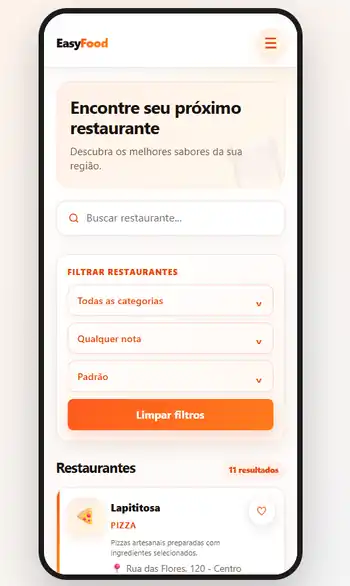
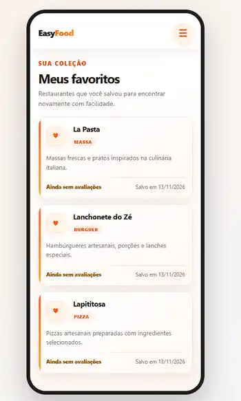
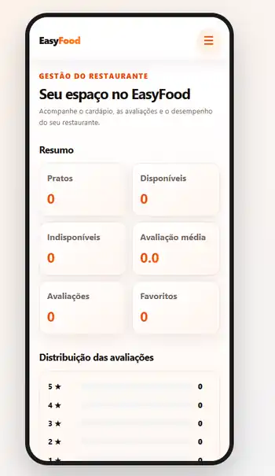
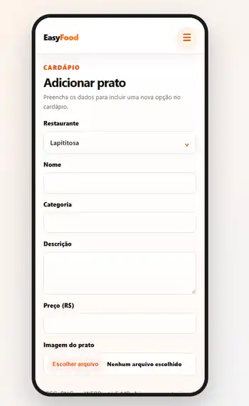
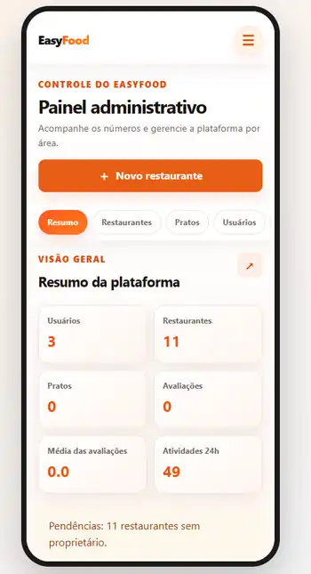
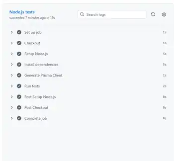

<p align="center"></p>

<p align="center">
  <a href="https://github.com/sandrozdb/easyfood-api/actions/workflows/ci.yml"></a>
  <a href="LICENSE"></a>
  
  
</p>

# EasyFood

MVP acadêmico de descoberta e gestão de restaurantes, construído em Node.js, Express, MySQL e Prisma. O projeto evoluiu de um CRUD simples para um **monólito modular** com autenticação real, autorização por perfis, ownership, avaliações, favoritos, imagens privadas, auditoria, dashboards analíticos e interface mobile-first.

## Status da entrega

**Baseline funcional concluída e validada.**

- **Backend:** Node.js + Express.
- **Persistência:** MySQL + Prisma ORM.
- **Autenticação:** Google federado pelo AWS Cognito.
- **Autorização:** JWT, RBAC e ownership server-side.
- **Perfis:** `cliente`, `restaurante` e `admin`.
- **Imagens:** Multer + Sharp + AWS S3 privado + URLs presignadas.
- **E-mail:** MailerSend por provider desacoplado, em modo best-effort.
- **Observabilidade funcional:** Activity Log administrativo.
- **Analytics:** dashboards para restaurante e administrador, usando apenas dados reais existentes.
- **Frontend:** HTML, CSS e JavaScript vanilla com experiência mobile-first.
- **Qualidade:** **355 testes aprovados, 0 falhas**, Prisma válido e `npm audit` sem vulnerabilidades na validação final local.
- **CI:** GitHub Actions executada com sucesso na `main`.

**Documentação rápida:** [Arquitetura](docs/architecture.md) · [Testes e QA](docs/testing-and-qa.md) · [Autenticação](docs/autenticacao-cognito-google.md) · [S3](docs/aws-s3-setup.md)

## Evidências da aplicação

As capturas abaixo registram os principais fluxos validados no ambiente local. Os valores exibidos refletem os dados existentes no momento de cada captura.

### Home e descoberta

<p align="center">
  
</p>

### Cliente — Favoritos

<p align="center">
  
</p>

### Restaurante — Dashboard

<p align="center">
  
</p>

A captura documenta a estrutura do dashboard e seus KPIs; a lógica dos indicadores também é coberta pela suíte automatizada.

### Restaurante — Cadastro de prato

<p align="center">
  
</p>

### Admin — Visão geral

<p align="center">
  
</p>

### CI — GitHub Actions

<p align="center">
  
</p>

## Funcionalidades

- listagem pública de restaurantes;
- busca, categoria, avaliação mínima e ordenação;
- detalhes do restaurante e cardápio;
- login Google via AWS Cognito;
- sincronização local do usuário autenticado;
- perfis `cliente`, `restaurante` e `admin` derivados de `cognito:groups`;
- CRUD de restaurantes e pratos com proteção de ownership;
- avaliações 1–5 com uma review por cliente/restaurante;
- favoritos persistentes por cliente;
- upload e processamento de imagens de prato;
- foto de perfil com objeto privado no S3;
- painel de restaurante com métricas reais;
- painel administrativo com indicadores e Activity Log;
- bloqueio/reativação local de usuários pelo administrador;
- interface mobile-first com navegação adaptada ao perfil.

## Arquitetura

```text
Frontend mobile-first
        ↓
Express Routes
        ↓
Controller
        ↓
Service
        ↓
Repository
        ↓
Prisma
        ↓
MySQL
```

Integrações externas são encapsuladas fora das regras principais:

```text
Google → AWS Cognito → access JWT → Auth Middleware → RBAC / Ownership

Multer → ImageService → Sharp → StorageService → AWS S3 privado

Domain Service → EmailService → EmailProvider → MailerSend
```

Os domínios ficam em `src/modules/`. A decisão por monólito modular e seus trade-offs estão registrados na [ADR-004](docs/adr/ADR-004-organizar-como-monolito-modular.md) e consolidados em [docs/architecture.md](docs/architecture.md).

## Perfis e autorização

| Perfil | Principais permissões |
| --- | --- |
| `cliente` | consultar restaurantes, favoritar, avaliar e gerenciar o próprio perfil |
| `restaurante` | administrar o próprio restaurante e seus pratos; consultar seu dashboard |
| `admin` | administrar a plataforma, vínculos, usuários ativos/inativos e dashboard global |

As permissões de perfil são gerenciadas por **grupos do AWS Cognito**. O painel administrativo apenas consulta a role sincronizada e permite ativar ou bloquear o usuário local; ele não altera grupos Cognito.

O backend nunca confia em `userId`, `owner_id` ou autoria enviados pelo frontend. A identidade vem do JWT validado.

## API principal

### Restaurantes e pratos

| Método e rota | Acesso |
| --- | --- |
| `GET /restaurants` | público |
| `POST /restaurants` | restaurante ou admin |
| `PUT/PATCH /restaurants/:id` | proprietário ou admin |
| `DELETE /restaurants/:id` | admin |
| `GET /restaurants/:restaurantId/dishes` | público |
| `POST /restaurants/:restaurantId/dishes` | proprietário ou admin |
| `GET /dishes/:dishId` | público |
| `PUT/PATCH/DELETE /dishes/:dishId` | proprietário ou admin |
| `GET /dishes/managed` | restaurante ou admin |

### Reviews

| Método e rota | Acesso |
| --- | --- |
| `GET /restaurants/:restaurantId/reviews` | público |
| `POST /restaurants/:restaurantId/reviews` | cliente |
| `GET /reviews/me` | cliente |
| `PUT/PATCH /reviews/:reviewId` | autor |
| `DELETE /reviews/:reviewId` | autor |

`averageRating` e `reviewCount` são derivados das Reviews. O campo legado `restaurants.rating` permanece apenas por compatibilidade.

### Favoritos

| Método e rota | Acesso |
| --- | --- |
| `POST /restaurants/:restaurantId/favorite` | cliente |
| `DELETE /restaurants/:restaurantId/favorite` | cliente |
| `GET /restaurants/:restaurantId/favorite` | cliente |
| `GET /favorites/me` | cliente |

### Dashboards

| Método e rota | Acesso |
| --- | --- |
| `GET /dashboard/restaurant` | restaurante |
| `GET /dashboard/admin` | admin |

O dashboard do restaurante identifica o estabelecimento por `owner_id = req.user.id`; não aceita um `restaurantId` arbitrário para selecionar os dados. O dashboard administrativo agrega totais globais. Nenhum dashboard inventa métricas de pedidos, faturamento ou vendas.

## Busca, filtros e ordenação

`GET /restaurants` aceita:

- `search`;
- `category`;
- `minRating`: `3`, `4` ou `4.5`;
- `sort`: `name_asc`, `name_desc`, `rating_desc`, `reviews_desc` ou `recent_desc`.

A página inicial mantém o estado dos filtros na URL e aplica debounce na busca.

## Imagens privadas

```text
Frontend → multipart/form-data → Multer → ImageService → Sharp
         → StorageService → S3 privado → object key no MySQL
         → URL presignada temporária na leitura
```

- `profile`: até 512×512, `cover`, sem upscale;
- `dish`: até 1600 px, proporção preservada, sem upscale;
- entrada: JPEG, PNG ou WebP;
- saída processada: WebP;
- bucket permanece privado.

Veja [docs/aws-s3-setup.md](docs/aws-s3-setup.md).

## Migrations

As migrations SQL estão em `database/migrations/` e devem ser aplicadas em ordem em uma base existente:

1. `001-cognito-users.sql`
2. `002-create-dishes.sql`
3. `003-add-dish-image-key.sql`
4. `004-create-activity-logs.sql`
5. `005-create-reviews.sql`
6. `006-add-user-profile-image.sql`
7. `007-create-favorites.sql`

Elas não são aplicadas automaticamente pelo Prisma.

## Execução local

Pré-requisitos: Node.js 20+, MySQL 8 e as configurações externas necessárias ao fluxo que será testado.

```powershell
npm install
if (-not (Test-Path ".env")) { Copy-Item ".env.example" ".env" }
notepad .env
npm run prisma:generate
npm run db:seed
npm start
```

Abra `http://localhost:3000`.

Para imagens com AWS Profile local:

```powershell
$env:AWS_PROFILE="easyfood"
npm start
```

Nunca versione `.env`, JWTs, chaves, secrets ou credenciais reais.

## Testes e qualidade

Validação final local registrada:

```text
355 testes
355 aprovados
0 falhas
```

Comandos de fechamento:

```powershell
npm test
npx prisma validate
npm audit
npm audit --omit=dev
git diff --check
```

A suíte cobre autenticação, JWT, RBAC, ownership, IDOR, restaurantes, pratos, dashboards, Reviews, Favoritos, Activity Log, e-mail, S3, Multer, Sharp, ImageService, frontend e XSS.

Os fluxos dos três perfis também foram validados manualmente ponta a ponta. O repositório **não possui Playwright nem uma suíte E2E automatizada**, portanto essa validação manual é documentada separadamente em [docs/testing-and-qa.md](docs/testing-and-qa.md).

## CI

A GitHub Actions roda em pushes e pull requests para `main`, usando Node.js 20, gera o Prisma Client e executa `npm test`.

A pipeline da `main` está configurada para validar automaticamente os testes a cada push e pull request.

## Decisões arquiteturais

- [ADR-001 — armazenamento em memória](docs/adr/ADR-001-armazenar-restaurantes-em-memoria.md)
- [ADR-002 — MySQL](docs/adr/ADR-002-adotar-mysql-para-persistencia.md)
- [ADR-003 — Prisma](docs/adr/ADR-003-adotar-prisma-como-orm.md)
- [ADR-004 — monólito modular](docs/adr/ADR-004-organizar-como-monolito-modular.md)
- [ADR-005 — planejamento Cognito](docs/adr/ADR-005-planejar-autenticacao-com-aws-cognito.md)
- [ADR-006 — Cognito, Google e RBAC](docs/adr/ADR-006-autenticacao-cognito-google-rbac.md)
- [ADR-007 — pratos e ownership](docs/adr/ADR-007-modulo-pratos-ownership.md)
- [ADR-008 — AWS S3](docs/adr/ADR-008-imagens-aws-s3.md)
- [ADR-009 — EmailService e MailerSend](docs/adr/ADR-009-email-service-mailersend.md)
- [ADR-010 — ImageService compartilhado](docs/adr/ADR-010-image-service-compartilhado.md)
- [ADR-011 — Favoritos de restaurantes](docs/adr/ADR-011-favoritos-restaurantes.md)

## Segurança

- JWT Cognito validado antes da sincronização local;
- RBAC e ownership no backend;
- proteção contra IDOR;
- S3 privado;
- conteúdo dinâmico renderizado com APIs seguras no frontend;
- Prisma no acesso a dados;
- `.env`, logs e caches locais ignorados;
- painel admin não administra grupos Cognito nem credenciais AWS.


## Licença e autor

Distribuído sob a licença MIT.

**Sandro Ferreira** — Consultoria · Inteligência Artificial · Dados · Automação  
[LinkedIn](https://linkedin.com/in/sandrozdb) · [GitHub](https://github.com/sandrozdb) · [Portfólio](https://sandrozdb.com)
