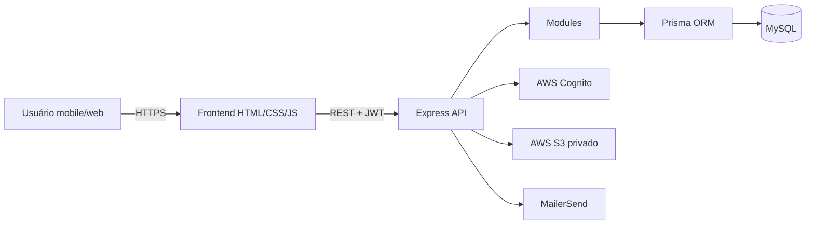
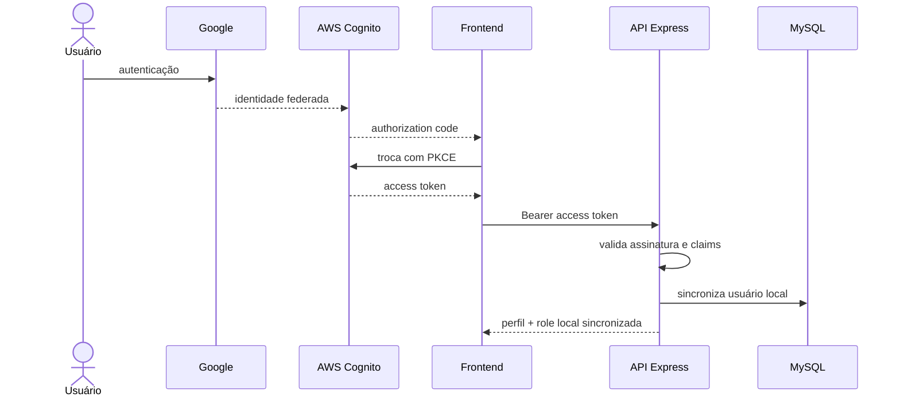
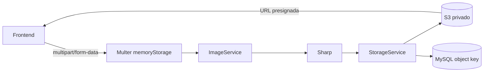

# Arquitetura do EasyFood

Este documento consolida a arquitetura implementada no EasyFood após a evolução do MVP para autenticação real, autorização por perfis, ownership, avaliações, favoritos, imagens privadas, auditoria, dashboards analíticos e interface mobile-first.

## Visão geral

O EasyFood é um **monólito modular**. A aplicação é executada em um único processo Node.js/Express, mas os domínios são separados em módulos internos com responsabilidades claras.



## Organização interna

```text
src/
├── app.js
├── config/
├── middlewares/
├── modules/
│   ├── activity/
│   ├── auth/
│   ├── dashboard/
│   ├── dishes/
│   ├── email/
│   ├── favorites/
│   ├── images/
│   ├── restaurants/
│   ├── reviews/
│   └── users/
└── services/
```

A organização segue domínio primeiro, e cada módulo usa somente as camadas que precisa.

## Fluxo principal de aplicação

```text
Route
  ↓
Controller
  ↓
Service
  ↓
Repository
  ↓
Prisma
  ↓
MySQL
```

Responsabilidades:

- **Route:** define endpoint e aplica middlewares de autenticação/autorização.
- **Controller:** traduz HTTP para o caso de uso e formata a resposta.
- **Service:** aplica regras de negócio, validações e composição de contratos.
- **Repository:** concentra acesso aos dados.
- **Prisma:** abstrai SQL e conecta ao MySQL.

## Autenticação e autorização



O backend valida assinatura, issuer, expiração, `token_use`, `client_id` e scope antes de confiar no token.

### Roles

Os perfis são derivados de `cognito:groups`:

1. `admin`;
2. `restaurante`;
3. `cliente`.

A prioridade evita ambiguidade quando mais de um grupo aparece no token.

O painel administrativo **não altera grupos Cognito**. A role aparece para consulta, enquanto o campo local `active` pode ser alterado para bloquear ou reativar o acesso.

## Ownership e IDOR

O sistema evita confiar em IDs de usuário enviados pelo navegador.

Exemplos:

- Review usa `req.user.id` como autor.
- Favorito usa `req.user.id` como dono.
- Dashboard de restaurante localiza o estabelecimento por `owner_id = req.user.id`.
- Escritas de restaurante e prato revalidam ownership no backend.

Esse desenho reduz risco de IDOR e mass assignment.

## Restaurantes e pratos

A relação principal é:

```text
User (restaurante)
   1
   │ owner_id único
   0..1
Restaurant
   1
   │
   N
Dish
```

Um usuário com role `restaurante` pode possuir no máximo um restaurante porque `owner_id` é único.

O administrador pode gerenciar restaurantes sem depender de ownership próprio.

## Reviews

```text
User (cliente) N ─── N Restaurant
                  Review
```

A constraint única `userId + restaurantId` garante no máximo uma avaliação por cliente/restaurante.

A média exibida é derivada das Reviews reais. O campo legado `restaurants.rating` não é fonte de verdade para analytics.

## Favoritos

```text
User (cliente) N ─── N Restaurant
                 Favorite
```

A constraint única evita favorito duplicado.

O dashboard do restaurante recebe apenas `favoriteCount`; não expõe identidade de quem favoritou.

## Dashboard analítico

### Restaurante

Endpoint:

```http
GET /dashboard/restaurant
```

Role permitida: `restaurante`.

Métricas:

- total de pratos;
- disponíveis;
- indisponíveis;
- média das Reviews;
- quantidade de Reviews;
- quantidade de Favoritos;
- distribuição de notas de 1 a 5;
- cinco Reviews mais recentes.

O restaurante é resolvido server-side pelo usuário autenticado.

### Admin

Endpoint:

```http
GET /dashboard/admin
```

Role permitida: `admin`.

Agrega:

- usuários total/ativos/inativos;
- distribuição de roles reconhecidas;
- restaurantes total/com proprietário/sem proprietário;
- pratos total/disponíveis/indisponíveis;
- Reviews total/média global;
- Favoritos total;
- Activity Logs total/24h/7d.

As consultas usam operações Prisma como `count`, `aggregate`, `groupBy`, `findMany` e `findUnique`, evitando carregar coleções completas apenas para contar.

## Imagens



### Presets

- perfil: até 512×512, `cover`, sem upscale;
- prato: até 1600 px, proporção preservada, sem upscale;
- entrada: JPEG, PNG ou WebP;
- saída: WebP.

A aplicação persiste object keys, não URLs presignadas.

## E-mail

```text
Domain Service
   ↓
EmailService
   ↓
EmailProvider
   ↓
MailerSendProvider
```

O envio é best-effort: falha do provedor externo não desfaz uma operação de domínio já concluída.

## Activity Log

Eventos administrativos e de domínio relevantes são registrados sem incluir segredos. Exemplos:

- restaurante criado/alterado/excluído;
- prato criado/alterado/excluído;
- imagem enviada/removida;
- Review criada/alterada/excluída;
- Favorito adicionado/removido;
- sincronização de role;
- tentativa de e-mail enviada/falha.

## Frontend

O frontend é HTML/CSS/JavaScript vanilla e segue direção **mobile-first**.

- largura de aplicativo em telas pequenas;
- experiência centralizada em telas maiores;
- navegação inferior conforme perfil;
- filtros, cards e formulários voltados a toque;
- conteúdo dinâmico preferencialmente via `textContent`, `createElement` e `replaceChildren`.

O frontend nunca é a autoridade de segurança.

## SOLID — avaliação honesta

- **SRP:** forte nos módulos de imagem, e-mail, auth, reviews, favoritos e dashboard; controllers, services e repositories têm papéis separados.
- **OCP:** providers de e-mail/storage e módulos independentes permitem evolução sem reescrever toda a aplicação.
- **LSP:** aplicado de forma prática nos providers/adapters substituíveis, sem interfaces formais de linguagem.
- **ISP:** contratos são pequenos e pragmáticos, mas JavaScript/CommonJS não formaliza interfaces.
- **DIP:** parcial/forte; services dependem de abstrações práticas em vários pontos, mas a composição principal ainda seleciona implementações concretas na inicialização.

## Trade-offs

- monólito modular reduz complexidade operacional, mas todos os módulos escalam e são publicados juntos;
- Cognito reduz responsabilidade sobre senhas, mas cria dependência externa e exige configuração correta de callbacks/grupos;
- S3 privado melhora segurança das imagens, mas depende da AWS para URLs presignadas;
- role é sincronizada a partir do token Cognito, portanto mudança de grupo depende de novo token/login para refletir claims atualizadas;
- migrations SQL são aplicadas de forma explícita e não automaticamente pelo Prisma;
- o projeto não possui fila, cache distribuído, observabilidade externa ou microserviços porque não são necessários ao escopo acadêmico atual.

## Decisões registradas

As decisões incrementais permanecem preservadas em `docs/adr/`, incluindo persistência, Prisma, monólito modular, Cognito, ownership, S3, e-mail, ImageService e Favoritos.
